<p align="center">
  
</p>

<p align="center">
  <a href="https://github.com/ishandutta2007/Awesome-Awesome-Awesome"></a>
  <a href="https://discord.gg/jc4xtF58Ve"></a>
  <a href="https://github.com/ishandutta2007/Awesome-AI-Workflow-Image-Generation/stargazers"></a>
  <a href="https://github.com/ishandutta2007/Awesome-AI-Workflow-Image-Generation/network/members"></a>
  <a href="https://github.com/ishandutta2007/Awesome-AI-Workflow-Image-Generation/pulls"></a>
  <a href="https://github.com/ishandutta2007/Awesome-AI-Workflow-Image-Generation/blob/main/LICENSE"></a>
  <a href="https://github.com/ishandutta2007/Awesome-AI-Workflow-Image-Generation"></a>
  <a href="https://github.com/ishandutta2007"></a>
</p>

---

# 🎨 Awesome AI Workflow & Image Generation 🚀

> **A comprehensive, SEO-optimized curated directory of generative AI image generation tools, modular node-based diffusion workflows, state-of-the-art open weights (FLUX, SDXL), and production creative suites.**

Welcome to the definitive hub for **AI workflow automation and image synthesis**. Whether you are building self-hosted modular pipelines with **ComfyUI**, deploying high-throughput inference with **Diffusers**, controlling character poses via **ControlNet** and **IP-Adapter**, or integrating enterprise-grade SaaS platforms like **Adobe Firefly** and **Canva**, this repository maps the state of the art across both commercial SaaS ecosystems and open-source generative engineering.

---

## 📑 Table of Contents 🧭

- [📈 Sector Overview & Market Dynamics](#-sector-overview--market-dynamics)
- [🏢 SaaS & Hosted Commercial Platforms](#-saas--hosted-commercial-platforms)
- [💻 Open-Source GitHub Projects](#-open-source-github-projects)
- [🧩 Key Architecture: From Prompting to Modular Pipelines](#-key-architecture-from-prompting-to-modular-pipelines)
- [🤝 How to Contribute](#-how-to-contribute)
- [🌟 Star History](#--star-history)
- [💖 Support & Community](#-support--community)
- [⚖️ Legal, Ethics & Licensing Disclaimer](#️-legal-ethics--licensing-disclaimer)

---

## 📈 Sector Overview & Market Dynamics

The global market for **AI Image Generation & Automated Creative Workflows** is valued at approximately **$1.8 Billion in 2024** and is forecast to reach **$12.5+ Billion by 2030**, expanding at a robust **Compound Annual Growth Rate (CAGR) of 38.2%**.

The ecosystem exhibits **moderate fragmentation characterized by a barbell market structure**:
- **Consolidated Incumbents at the Distribution Edge:** Enterprise platforms such as **Adobe** (Creative Cloud integration and full copyright indemnification) and **Canva** (democratized graphics suites and Leonardo AI acquisition) dominate corporate and marketing seats. In parallel, consumer aesthetic mindshare is held by closed labs like **Midjourney**.
- **Distributed Innovation in Open Diffusion:** True workflow orchestration, node-based procedural generation, fine-tuning infrastructure, and privacy-critical on-premise execution remain highly fragmented. Open-weight breakthroughs (e.g., **Black Forest Labs' FLUX**, **Stability AI**, **ComfyUI**, **ControlNet**) continuously disrupt proprietary moats, empowering independent creators and studios with vendor-independent pipelines that resist winner-take-all monopolization.

---

## 🏢 SaaS & Hosted Commercial Platforms

A curated comparison of leading hosted image generation and creative pipeline platforms. Sorted in **descending order by company scale (market cap, valuation, or annual revenue)**.

| 🏷️ Platform / Product | 📊 Company Scale (Valuation / Revenue) | 💳 Starting Tier Pricing | 🎁 Free Tier / Trial Limits | 🌟 Core Focus & Differentiators |
| :--- | :--- | :--- | :--- | :--- |
| **[Adobe Firefly](https://www.adobe.com/products/firefly.html)** | **Market Cap: ~$165B**<br>*(FY24 Rev: ~$21.4B)* | **$4.99 / month**<br>*(Firefly Standard - 100 gen credits/mo)* | **25 generative credits / month** free forever (requires Adobe ID; refreshes monthly) | Commercially indemnified model trained strictly on licensed Adobe Stock and public domain data; native Photoshop & Illustrator Generative Fill. |
| **[Canva Magic Media](https://www.canva.com/)** | **Valuation: ~$32B – $39B**<br>*(ARR: ~$2.3B)* | **$15.00 / month**<br>*(or $120.00/yr / $10/mo billed annually)* | **50 lifetime text-to-image queries** on the Canva Free Forever plan | Deeply embedded into Canva's all-in-one graphic design suite; includes Magic Eraser, Magic Switch, and text-to-presentation tools. |
| **[Midjourney](https://www.midjourney.com/)** | **Valuation: ~$10B est.**<br>*(ARR: ~$300M, bootstrapped)* | **$10.00 / month**<br>*(or $96.00/yr / $8/mo billed annually)* | **No permanent free tier**; periodic promotional trials (e.g. 25 fast GPU minutes during new model rollouts) | Gold standard for cinematic, painterly, and photorealistic aesthetics; web interface, Discord bot, and high prompt coherence. |
| **[Runway](https://runwayml.com/)** | **Valuation: ~$4B**<br>*(ARR: ~$60M+)* | **$15.00 / user / month**<br>*(or $144.00/yr / $12/mo billed annually)* | **125 one-time generation credits** upon sign-up (does not renew monthly), 3 video projects, 5GB assets | Full multimodal generative studio; leading video synthesis (Gen-2 / Gen-3 Alpha), motion brush, camera control, and generative audio. |
| **[Picsart AI](https://picsart.com/)** | **Valuation: ~$1.5B**<br>*(ARR: ~$100M+)* | **$13.00 / month**<br>*(or $60.00/yr / $5/mo billed annually)* | **7-day free trial** of Gold with full access; free forever tier includes 5 basic generation tokens/day with watermark | Mobile-first content creation suite with AI background changer, face enhancements, social media templates, and avatar creation. |
| **[Photoroom](https://www.photoroom.com/)** | **Valuation: ~$500M**<br>*(ARR: ~$45M; $43M Series B)* | **$12.99 / month**<br>*(or $89.99/yr / ~$7.50/mo billed annually)* | **Unlimited free standard-res cutouts** with watermark forever + **7-day Pro free trial** with HD unwatermarked exports | Dedicated to e-commerce product staging, shadow injection, batch background elimination, and catalog automation. |
| **[Leonardo AI](https://leonardo.ai/)** | **Acquired: ~$320M**<br>*(Acquired by Canva in 2024)* | **$12.00 / month**<br>*(or $120.00/yr / $10/mo billed annually)* | **150 fast tokens / day renewed every 24 hours** (~75 standard image generations free daily) | Real-time Canvas, custom LoRA fine-tuning on user assets, video motion generation, and proprietary Phoenix foundation model. |
| **[Freepik Pikaso](https://www.freepik.com/ai/image-generator)** | **Valuation: ~$300M+**<br>*(ARR: ~$100M+)* | **$16.50 / month**<br>*(or $120.00/yr / $10/mo billed annually)* | **20 free generation and upscale credits daily** renewed every 24 hours upon free registration | High-speed sketch-to-image canvas (real-time rendering as you draw), integrated upscale engines, and direct connection to Freepik's asset library. |
| **[Topaz Labs](https://www.topazlabs.com/)** | **Valuation: ~$200M est.**<br>*(ARR: ~$50M+)* | **$99.00 one-time perpetual license**<br>*(Gigapixel AI) or $199/yr (Photo AI)* | **30-day free trial** for standalone desktop suites (fully functional with watermarked output) | Industry benchmark for generative high-magnification upscaling (Gigapixel AI), noise suppression, and camera lens correction. |
| **[Magnific AI](https://magnific.ai/)** | **Acquired: ~$30M – $50M est.**<br>*(Acquired by Freepik in 2024)* | **$39.00 / month**<br>*(or $390.00/yr / $32.50/mo billed annually)* | **50 promotional testing credits** on verified affiliate/partner campaign sign-ups (no permanent free tier) | Hallucinatory upscaling and detail synthesis; "Fractal" texture generation engine that reimagines micro-details at 8K+ resolutions. |

---

## 💻 Open-Source GitHub Projects

The open-source generative AI landscape represents the cutting edge of node-based workflow engineering, spatial conditioning, and unconstrained model hosting. 

The list below is strictly **sorted in descending order by GitHub Star count**, featuring a real-time social star badge linked to each repository's stargazers page:

1. **[AUTOMATIC1111/stable-diffusion-webui](https://github.com/AUTOMATIC1111/stable-diffusion-webui)** [](https://github.com/AUTOMATIC1111/stable-diffusion-webui/stargazers)  
   *The definitive, browser-based Stable Diffusion interface that kickstarted the local generative movement (AGPL-3.0).*  
   - Comprehensive suite supporting txt2img, img2img, inpainting, outpainting, and prompt matrix sweeps.
   - Rich ecosystem of thousands of custom community extensions, scripts, and parameter sliders.
   - Reference platform for testing community checkpoints, embeddings, and hypernetworks.

2. **[comfyanonymous/ComfyUI](https://github.com/comfyanonymous/ComfyUI)** [](https://github.com/comfyanonymous/ComfyUI/stargazers)  
   *The industry standard for node-based, procedural generative pipelines (GPL-3.0).*  
   - Visual node-graph architecture where models, VAEs, latents, conditioning, and samplers connect modularly.
   - Workflows save directly into image metadata as JSON, ensuring 100% reproducible and shareable execution graphs.
   - Native support for SD 1.5, SDXL, FLUX.1, AnimateDiff, ControlNet, IP-Adapter, and Stable Video Diffusion.

3. **[lllyasviel/Fooocus](https://github.com/lllyasviel/Fooocus)** [](https://github.com/lllyasviel/Fooocus/stargazers)  
   *Minimalist, prompt-and-generate Stable Diffusion XL application inspired by Midjourney simplicity (GPL-3.0).*  
   - Zero-configuration installation with automated prompt expansion (GPT-2 based prompt refinement).
   - Built-in cinematic style presets, refiner scheduling, and native face swapping/inpainting mechanisms.

4. **[upscayl/upscayl](https://github.com/upscayl/upscayl)** [](https://github.com/upscayl/upscayl/stargazers)  
   *Free, cross-platform open-source AI image upscaler desktop application (AGPL-3.0).*  
   - Powered by Real-ESRGAN and Vulkan-based NCNN neural engines for high-speed local GPU processing.
   - Clean, modern desktop GUI supporting batch upscaling, double-upscaling, and sharpening.

5. **[TencentARC/GFPGAN](https://github.com/TencentARC/GFPGAN)** [](https://github.com/TencentARC/GFPGAN/stargazers)  
   *Practical face restoration algorithm for real-world blind face restoration and post-processing (Apache-2.0).*  
   - Uses generative facial prior (GFP) via spatial feature transform layers to synthesize authentic facial details.
   - Essential post-generation node for fixing eyes, teeth, and skin artifacts in diffusion-generated portraits.

6. **[xinntao/Real-ESRGAN](https://github.com/xinntao/Real-ESRGAN)** [](https://github.com/xinntao/Real-ESRGAN/stargazers)  
   *Practical algorithms for general image and anime super-resolution restoration (BSD-3-Clause).*  
   - Trained on purely synthetic data to handle complex real-world degradations and blur.
   - The foundational backbone behind many local upscaling tools and ComfyUI upscaler nodes.

7. **[huggingface/diffusers](https://github.com/huggingface/diffusers)** [](https://github.com/huggingface/diffusers/stargazers)  
   *The premier Python library for state-of-the-art diffusion models in production and research (Apache-2.0).*  
   - Standardized PyTorch pipelines for FLUX.1, SDXL, Stable Diffusion, Kandinsky, and latent consistency models.
   - Modular components for schedulers (DDIM, Euler, DPM++), attention processors, and distributed GPU training.

8. **[lllyasviel/ControlNet](https://github.com/lllyasviel/ControlNet)** [](https://github.com/lllyasviel/ControlNet/stargazers)  
   *Seminal architecture adding spatial conditioning controls to large text-to-image diffusion models (Apache-2.0).*  
   - Enables fine-grained spatial steering using Canny edges, OpenPose human poses, Depth maps, and Surface Normals.
   - Transformed diffusion models from random lotteries into deterministic commercial design tools.

9. **[facefusion/facefusion](https://github.com/facefusion/facefusion)** [](https://github.com/facefusion/facefusion/stargazers)  
   *Next-generation face swapper and enhancer CLI and GUI for photos and video pipelines (GPL-3.0).*  
   - High-performance facial tracking, occlusion masking, lip syncing, and multi-model face swapping pipelines.

10. **[invoke-ai/InvokeAI](https://github.com/invoke-ai/InvokeAI)** [](https://github.com/invoke-ai/InvokeAI/stargazers)  
    *The creative engine for professionals featuring a unified canvas and multi-layer painting interface (Apache-2.0).*  
    - Unified canvas for continuous outpainting, iterative sketch-to-image, and regional prompt masking.
    - Clean asset management boards, non-destructive adjustment layers, and commercial studio workflows.

11. **[Stability-AI/generative-models](https://github.com/Stability-AI/generative-models)** [](https://github.com/Stability-AI/generative-models/stargazers)  
    *Official research repository for Stability AI foundation models including SDXL and SVD (MIT).*  
    - Native 1024×1024 base checkpoint architectures, refiners, and micro-conditioning implementations.
    - Source repository for Stable Video Diffusion (SVD) and Stable Audio architectures.

12. **[black-forest-labs/flux](https://github.com/black-forest-labs/flux)** [](https://github.com/black-forest-labs/flux/stargazers)  
    *State-of-the-art 12B parameter rectified flow transformer image generation models (Apache-2.0 / Open-Weight).*  
    - Developed by the original creators of Stable Diffusion; sets current SOTA in prompt adherence, typography, and hands.
    - **FLUX.1 [schnell]** is permissively licensed under Apache 2.0 for personal and commercial usage.

13. **[Sanster/IOPaint](https://github.com/Sanster/IOPaint)** [](https://github.com/Sanster/IOPaint/stargazers)  
    *Image inpainting and outpainting tool powered by SOTA AI models (Apache-2.0).*  
    - Free and open-source tool (formerly Lama Cleaner) for removing unwanted objects, watermarks, and people.
    - Supports AnyText, SD Inpainting, PowerPaint, Mat, and Lama models with real-time browser canvas.

14. **[Mikubill/sd-webui-controlnet](https://github.com/Mikubill/sd-webui-controlnet)** [](https://github.com/Mikubill/sd-webui-controlnet/stargazers)  
    *The most installed webui extension, integrating ControlNet conditioning directly into AUTOMATIC1111 (GPL-3.0).*  
    - Multi-ControlNet slot handling, batch processing, preprocessor model caching, and custom script integrations.

15. **[ltdrdata/ComfyUI-Manager](https://github.com/ltdrdata/ComfyUI-Manager)** [](https://github.com/ltdrdata/ComfyUI-Manager/stargazers)  
    *The essential package manager for installing, updating, and repairing ComfyUI custom nodes and models (GPL-3.0).*  
    - Detects missing nodes inside imported workflow JSON files and installs them automatically with single-click ease.

16. **[lllyasviel/stable-diffusion-webui-forge](https://github.com/lllyasviel/stable-diffusion-webui-forge)** [](https://github.com/lllyasviel/stable-diffusion-webui-forge/stargazers)  
    *High-performance fork of AUTOMATIC1111 with optimized memory management and faster backend (AGPL-3.0).*  
    - Drastically reduced VRAM overhead and accelerated inference for low-memory GPUs (supports SDXL and FLUX natively).

17. **[bmaltais/kohya_ss](https://github.com/bmaltais/kohya_ss)** [](https://github.com/bmaltais/kohya_ss/stargazers)  
    *The gold standard GUI and script suite for LoRA, LyCORIS, and Dreambooth model fine-tuning (Apache-2.0).*  
    - Supports SD 1.5, SDXL, and FLUX training with custom learning rate schedules, captioning, and bucketed resolutions.

18. **[guoyww/AnimateDiff](https://github.com/guoyww/AnimateDiff)** [](https://github.com/guoyww/AnimateDiff/stargazers)  
    *Animate personalized text-to-image diffusion models without domain-specific re-training (Apache-2.0).*  
    - Inserts temporal motion modeling modules into existing community diffusion models for smooth animation loops.

19. **[Acly/krita-ai-diffusion](https://github.com/Acly/krita-ai-diffusion)** [](https://github.com/Acly/krita-ai-diffusion/stargazers)  
    *Generative AI plugin for Krita with local ComfyUI backend integration (GPL-3.0).*  
    - Inpainting, region-guided generation, live drawing canvas rendering, and layer-based image editing inside digital painting software.

20. **[tencent-ailab/IP-Adapter](https://github.com/tencent-ailab/IP-Adapter)** [](https://github.com/tencent-ailab/IP-Adapter/stargazers)  
    *Image Prompt Adapter for using image references as conditioning prompts (Apache-2.0).*  
    - Decoupled cross-attention mechanism that preserves visual identity, style transfer, and face characteristics with high fidelity.

---

## 🧩 Key Architecture: From Prompting to Modular Pipelines 🛠️

Modern generative workflows have transitioned from **one-shot prompt roulette** to **deterministic visual engineering**:

```
[Text Prompt + Negative] ──┐
                           ▼
[Reference Style / Face] ──▶ [IP-Adapter] ──┐
                                             ▼
[Pose / Depth / Edge] ─────▶ [ControlNet] ──▶ [K-Sampler (Euler/DPM++)] ──▶ [VAE Decode] ──▶ [Upscale / Detailer]
                                             ▲
[Base Model / Checkpoint] ──────────────────┘
```

1. **Procedural Control Nodes:** By combining **ControlNet** (compositional geometry) with **IP-Adapter** (character and style consistency), creators achieve reproducible art direction across sequences.
2. **LoRA Fine-Tuning:** Lightweight Low-Rank Adaptations trained via **kohya_ss** provide custom product concepts or artistic styles without altering base model foundation weights.
3. **Reproducible Graphs:** Tools like **ComfyUI** encode entire pipeline parameters—seed, guidance, denoise factor, checkpoints, upscalers—directly into JSON files, establishing version-controlled visual pipelines.

---

## 🤝 How to Contribute 💡

We welcome additions, corrections, and new tool submissions from artists, researchers, and developers!

1. 🍴 **Fork the repository** on GitHub.
2. 🌿 **Create a dedicated branch**: `git checkout -b feat/add-new-pipeline-tool`.
3. 📝 **Add your entry**:
   - For **SaaS tools**: Provide exact company scale/valuation, specific starting prices, specific free tier/trial limits, and core differentiators.
   - For **Open-Source tools**: Include repository URL, social star badge link (`style=social&color=white`), license, and description. Place it in the correct position according to its stargazer count.
4. 🚀 **Submit a Pull Request** with a concise summary of the changes.

---

##  Star History

[](https://star-history.dera.page/#ishandutta2007/Awesome-AI-Workflow-Image-Generation&type=date&legend=top-left)

---

## 💖 Support & Community

Thank you so much for exploring and supporting **Awesome AI Workflow & Image Generation**! 🙏

If this curated directory has helped you in your creative projects, production workflows, or research:
- ⭐ **Star the repo:** Show your love and help other developers and artists discover this resource!
- 🍴 **Fork & Contribute:** Help keep models, nodes, and pricing data fresh and comprehensive.
- 📢 **Share:** Spread the word across Twitter/X, LinkedIn, Discord, and Reddit communities.
- ☕ **Buy a Coffee / Sponsor:** If you would like to support maintenance and curation, check out the maintainer's [GitHub Sponsors Dashboard](https://github.com/sponsors/ishandutta2007).

<p align="center">
  <a href="https://github.com/sponsors/ishandutta2007">
    
  </a>
</p>

---

## ⚖️ Legal, Ethics & Licensing Disclaimer 🛡️

- **Copyright & Commercial Indemnification:** AI models vary widely in copyright provenance. **Adobe Firefly** offers explicit commercial indemnification based on licensed Adobe Stock data. Open-weight models (SDXL, FLUX, Stable Diffusion) carry varying license covenants (e.g., Apache-2.0 vs. CreativeML Open RAIL-M vs. non-commercial research licenses). Verify the upstream repository's `LICENSE` file before deploying in commercial production.
- **Provenance & Disclosure:** Production outputs may be subject to global disclosure mandates, such as the EU AI Act (Article 50) and C2PA Content Credentials.
- **Hardware Recommendations:** Self-hosting diffusion models locally typically requires an NVIDIA GPU with at least 8 GB VRAM for SD 1.5, 12–16 GB VRAM for SDXL, and 16–24+ GB VRAM for FLUX.1 [dev] and high-resolution video synthesis.

---

<p align="center">
  <b>Built with ❤️ for artists, designers, and AI engineers shaping next-generation creative workflows.</b><br>
  <i>Starred this repository? Share it with the creative AI community! 🌟</i>
</p>
